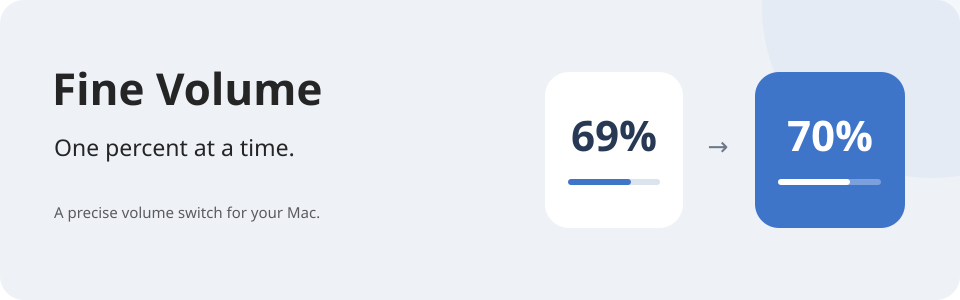

# Fine Volume

**Your volume. One percent at a time.**



A native macOS menu-bar app for precise volume control.
Hold Control and press a volume key to move one percentage point.
Release Control and the normal volume keys work as usual.

[**Download for macOS →**](https://github.com/nickdrezza/FineVolume/releases/latest)

## Find the right level

| Shortcut | Action |
| --- | --- |
| `Control + Volume Up` | Increase volume by 1 percentage point. |
| `Control + Volume Down` | Decrease volume by 1 percentage point. |
| `Control + Option + Command + Shift + Up/Down` | Use the arrow-key fallback. |

A small volume display shows each change. Hover over the menu-bar speaker to see the level.
Click it to see the up/down keys, **Open at Login**, and **Quit Fine Volume**.
The menu shows Control + volume keys when ready, or the arrow-key fallback otherwise.

## Install

1. Download `FineVolume.zip` from the [latest release](https://github.com/nickdrezza/FineVolume/releases/latest).
2. Unzip it and move `FineVolume.app` to Applications.
3. Open the app. Select **Open Permissions** and enable **Input Monitoring** in System Settings.
4. Return to the app and choose whether it should launch at login.

Requires macOS 13 or later and an Apple silicon or Intel Mac.
The release is a universal app. Your audio output must support software volume control.
Some HDMI, USB, aggregate, and professional devices do not. The app reports this in its menu.

The current releases are not Developer ID notarized. macOS can block a downloaded copy.
You can build from source instead.

## Permissions and privacy

Input Monitoring lets the app detect when Control is held. The event tap listens only for
modifier changes, not normal typing. The arrow-key fallback works without that permission.
Open at Login stays off until you choose it and can be managed in System Settings.

Read [PRIVACY.md](PRIVACY.md) for the full privacy statement.

<details>
<summary>How the shortcuts work</summary>

While Control is held, Apple's HID API routes the two physical volume keys to the 1% handler.
The mapping is removed when Control is released. The fallback uses the global hot-key API.
Core Audio changes the current output device's volume.

The app does not request Accessibility, microphone, audio recording, Screen Recording,
or network access. The HID mapping requires no special privilege.
Launch at Login uses Service Management and appears in System Settings → General → Login Items.

AppKit provides the menu-bar interface and temporary volume display.
See [Architecture](docs/ARCHITECTURE.md) for the implementation.

</details>

## Build from source

Install Apple's command-line developer tools. The project has no third-party dependencies.

```sh
git clone https://github.com/nickdrezza/FineVolume.git
cd FineVolume
make test
make package
```

The universal app and ZIP archive are written to `dist/`.
[CI](https://github.com/nickdrezza/FineVolume/actions/workflows/ci.yml) checks the project.

## Contribute

See [CONTRIBUTING.md](CONTRIBUTING.md) for the local workflow and project rules.

## License

This project is licensed under [GNU AGPLv3 only](LICENSE) (`AGPL-3.0-only`).
See [NOTICE](NOTICE) for copyright information.

You can use, change, and sell copies under the license terms.
If you distribute covered code, provide its source under the same license.
If you change the project and let users access it over a network,
offer those users the source of your version.

Earlier releases keep the license terms that applied to them.
